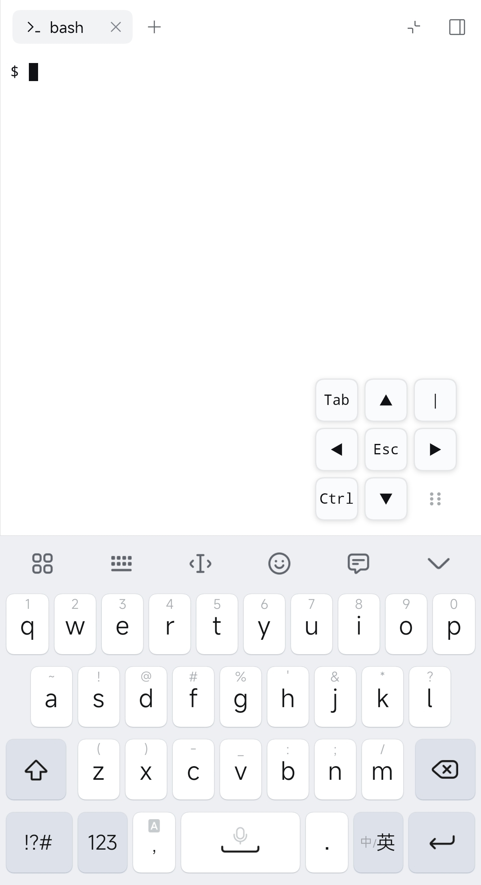

# dsh-terminal-keypad

English | [中文](README.zh.md)

A floating, almost transparent keypad for the DSH Web terminal. It supplies the
keys a phone's soft keyboard does not have — **Esc**, **Tab**, **Ctrl**, **`|`**
and the four arrow keys — and turns an outward slide on an arrow into
**Home / End / Page Up / Page Down**.



## Layout

```
      ┌─────┬─────┬─────┐
      │ Tab │  ▲  │  |  │
      ├─────┼─────┼─────┤
      │  ◀  │ Esc │  ▶  │
      ├─────┼─────┼─────┤
      │Ctrl │  ▼  │ ⠿   │
      └─────┴─────┴─────┘
```

The four arrow keys form a plus around **Esc**. **Tab** sits in the upper-left
corner, **`|`** in the upper-right, **Ctrl** in the lower-left, and the
lower-right cell is the drag grip.

## What you can do

| Cell | Tap / press | Hold | Slide outward, then release |
|---|---|---|---|
| **▲ ▼ ◀ ▶** | move the cursor | keep moving | **Page Up / Page Down / Home / End** |
| **Esc** | send Escape | — | — |
| **Tab** | send Tab | — | — |
| **`\|`** | type the current symbol | — | slide up to pick another symbol |
| **Ctrl** | arm Ctrl | — | — |
| **⠿** | — | drag the pad | — |

### Hold an arrow to repeat it

Press and hold a direction key and it keeps moving: the repeat gets faster the
longer you hold, and stops the moment you release.

### Slide an arrow outward for a function key

Touch an arrow and slide it outward, then release:

- ▲ → **Page Up**
- ▼ → **Page Down**
- ◀ → **Home**
- ▶ → **End**

The key shows the function key's name while you slide, and the arrow itself is
not sent first, so a slide never moves the cursor or rewrites your shell history.

### Slide up on the symbol key to pick another symbol

The key in the upper-right is not fixed to `|`. Slide up on it and a small picker
of common terminal symbols opens — pipes, redirects, quotes, brackets, operators
and more. Tap one and the key takes it, ready for the next press, and the choice
is remembered for next time. A plain press still types the symbol the key holds.

### Ctrl is sticky

Tap **Ctrl** — it highlights — and the next key is sent with Control held:

- a pad key becomes **Ctrl+Arrow** or **Ctrl+`|`**;
- a character you type into the terminal becomes its control key, so `c` arrives
  as Ctrl-C, `m` as Enter, `z` as Ctrl-Z, and so on.

Ctrl resets after one use; tap it again to cancel. Typing anywhere outside the
terminal is never touched.

### Move it where you want

Drag the **⠿** grip. The pad follows your finger, always stays on screen
(including above the soft keyboard), and remembers where you left it.

## Appearance

The pad is made to sit on top of live terminal text without hiding it: the keys
are a barely-there tint rather than a solid panel, the text behind stays sharp,
and the outline keeps the keys easy to find. It follows the DSH theme, so light,
dark and custom theme settings all apply.

It only appears while a terminal is actually on screen, floats against the
terminal's lower-right corner by default, and disappears when you switch to
another right-sidebar tab.

## Install

The package is a DSH bundle; install the directory into the current profile:

```text
plugin_manager  action=install_bundle  target=/absolute/path/to/terminal-keypad
```

The profile links this directory, so **moving the folder breaks the install** —
reinstall from the new path if you move it.

Remove it with:

```text
plugin_manager  action=remove_bundle  target=dsh-terminal-keypad
```

## How it works

<details>
<summary>Implementation details</summary>

- `index.js` is the Host half, an empty `apply()` that exists only so the bundle
  row has a Host activation. All behavior lives in `client.js`.
- `client.js` registers one entry into the `shell.overlay` slot
  (id `terminal-keypad`) and portals its DOM to `document.body`: the overlay
  layer is `z-index: 20`, below a fullscreen right-sidebar panel at `z-index: 40`.
- Input goes through the public Client terminal service,
  `ctx.webTerminals.view(sessionId, tabId, contentId).write(data)`. It reuses the
  cached view the sidebar's terminal body already owns, so no second attachment
  competes for the terminal; writes are dropped while another page owns input
  (the terminal's own "take control" contract).
- Visibility and position come from measuring the live `.xterm` screen
  (`getBoundingClientRect` intersected with the visual viewport, then
  `elementFromPoint` probes) on gestures and a 500 ms poll, so collapsing and
  reopening the right sidebar always brings the pad back.

### Bytes sent

| Key | Bytes |
|---|---|
| Esc | `ESC` |
| Tab | `\t` |
| `\|` | the symbol the key holds (`\|` by default) |
| ▲ ▼ ◀ ▶ | `ESC[A` / `ESC[B` / `ESC[D` / `ESC[C` |
| Ctrl + arrow | `ESC[1;5A` … `ESC[1;5D` |
| Ctrl + `\|` | the symbol's control byte when it has one (`0x1C` for `\|`) |
| Home / End | `ESC[H` / `ESC[F` |
| Page Up / Page Down | `ESC[5~` / `ESC[6~` |

### Sticky Ctrl while typing

The next character typed into the focused terminal becomes its control byte:
`a`–`z` → `0x01`–`0x1A`, `[` → `ESC`, `]` → `0x1D`, `^` → `0x1E`, `_` → `0x1F`,
`@` → `0x00`, `?` → `0x7F`. A `keydown` capture listener handles physical and
soft keyboards, with a `beforeinput` fallback for IME input that carries no
usable key.

### Tuning

Constants at the top of `client.js`:

| Constant | Value | Meaning |
|---|---|---|
| `CELL` / `GAP` / `INSET` | 36 / 5 / 12 | cell size, gap and default inset, in px |
| `TAP_GRACE` | 90 ms | delay before an arrow sends, so a slide can replace it |
| `SWIPE_DISTANCE` | 13 px | outward travel that turns an arrow into its function key |
| `REPEAT_DELAY` | 420 ms | delay before a held arrow starts repeating |
| `REPEAT_START` / `REPEAT_MIN` | 160 / 80 ms | first repeat period / fastest period |
| `REPEAT_ACCEL` | 0.85 | period multiplier per repeat |
| `OFFSET_KEY` | `dsh-terminal-keypad:offset.v1` | `localStorage` key of the drag offset |
| `SYMBOL_KEY` | `dsh-terminal-keypad:symbol.v1` | `localStorage` key of the chosen symbol |

</details>

## Files

| File | Purpose |
|---|---|
| `client.js` | the whole feature: pad, gestures, input |
| `index.js` | Host activation stub |
| `cordis.patch.yml` | inserts the `terminal-keypad` Host row |
| `package.json` | manifest and `dsh.client` declaration |
| `locale/en.json`, `locale/zh.json` | Plugin Manager title and description |
| `icon.svg` | plugin icon |
| `doc/Screenshot_2026-11-14.jpg` | the screenshot above |

## License

MIT — see [LICENSE](LICENSE).
