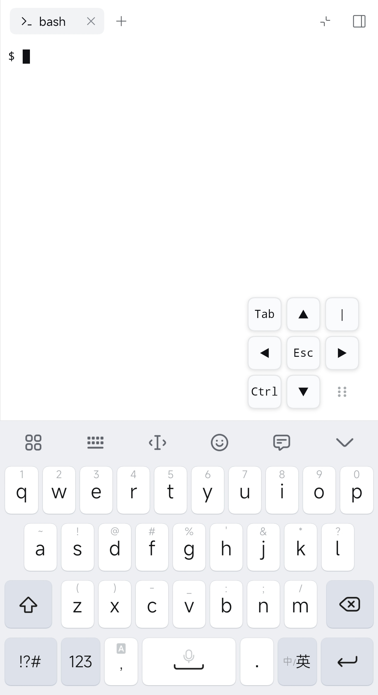

# dsh-terminal-keypad

[English](README.md) | 中文

一个悬浮在 DSH Web 终端上的、近乎透明的按键面板。它补齐手机软键盘没有的
**Esc**、**Tab**、**Ctrl**、**`|`** 和四个方向键，并支持在方向键上向外滑动，
改为发送 **Home / End / Page Up / Page Down**。



## 布局

```
      ┌─────┬─────┬─────┐
      │ Tab │  ▲  │  |  │
      ├─────┼─────┼─────┤
      │  ◀  │ Esc │  ▶  │
      ├─────┼─────┼─────┤
      │Ctrl │  ▼  │ ⠿   │
      └─────┴─────┴─────┘
```

四个方向键围绕 **Esc** 呈加号排列。左上角是 **Tab**，右上角是 **`|`**，
左下角是 **Ctrl**，右下角是拖动把手。

## 每个格子的作用

| 格子 | 点按 / 按下 | 按住 | 向外滑动后松开 |
|---|---|---|---|
| **▲ ▼ ◀ ▶** | 发送方向键（`ESC[A`…`ESC[D`） | 持续重复发送方向键 | **Page Up / Page Down / Home / End** |
| **Esc** | 发送 `ESC` | — | — |
| **Tab** | 发送 Tab | — | — |
| **`\|`** | 发送 `\|` | — | — |
| **Ctrl** | 选中粘滞的 Control 修饰键 | — | — |
| **⠿** | — | 拖动面板 | — |

### 按住方向键连续发送

按住方向键会先发送一次，等待 **420ms** 后开始重复：重复间隔从 **160ms** 起，
每次乘以 0.85 逐步加速，最低到 **80ms** 后保持不变。松手、窗口失焦、页面切到
后台或面板卸载，都会立即停止重复。

### 方向键向外滑动发送功能键

按住方向键，并沿该方向滑动至少 **13px**：

| 起点 | 发送 |
|---|---|
| ▲ | **Page Up**（`ESC[5~`） |
| ▼ | **Page Down**（`ESC[6~`） |
| ◀ | **Home**（`ESC[H`） |
| ▶ | **End**（`ESC[F`） |

滑出阈值后，键面会实时换成功能键的名字，松手时才发送。方向键本身延后
**90ms** 发送，确保有意的滑动不会先把方向键发出去——在 shell 里误发一个
`↑` 会把命令行从历史里改写；如果滑动开始得比这 90ms 更晚，可能仍会先发出
一次方向键。

### Ctrl 是粘滞修饰键

点一下 **Ctrl**（按键高亮，`aria-pressed="true"`），接下来的按键会带上
Control 修饰：

- 按下键盘面板上的键：**Ctrl+方向键**（`ESC[1;5A`…）或 **Ctrl+`|`**
  （`0x1C`，即 Ctrl+\ 产生的字节）；
- 在已聚焦的终端里输入字符：转换为对应的控制字节——`c` → `0x03`、
  `d` → `0x04`、`m` → `0x0D`、`z` → `0x1A`、`[` → `ESC`、`]` → `0x1D`、
  `^` → `0x1E`、`_` → `0x1F`、`@` → `0x00`、`?` → `0x7F`。

Ctrl 用过一次后自动复位，再点一次可取消。焦点在终端以外时完全不拦截输入。

### 拖动位置

按住 **⠿** 把手拖动即可移动面板。面板跟随指针、始终被限制在可视区域内
（包括避开软键盘），并把相对终端右下角的偏移记在 `localStorage` 里，
下次打开仍在原处。

## 外观

面板要盖在实时滚动的终端文字上，因此刻意做得尽量不遮挡：

- 每个键只有 **24%** 的主题令牌底色，且**不做背景模糊**，底下的文字保持可读；
- 字形完全不透明，并带一圈底色光晕；
- 描边为 `--dsw-alias-border-l2` 的 **82%**；
- 全部使用 `--dsw-alias-*` 主题令牌，亮色、暗色和用户令牌覆盖都会生效。

面板尺寸 118 × 118 px（36px 键格、5px 间距）。只有页面上确实能看到终端画面时
才会出现，默认贴在终端的右下角；终端被隐藏或右侧边栏切到其他标签时会自动消失。

## 安装

本包是一个 DSH bundle，把目录安装到当前 profile 即可：

```text
plugin_manager  action=install_bundle  target=/absolute/path/to/terminal-keypad
```

安装结果会返回 `application: applied`，并把 `dsh-terminal-keypad` 加入 profile
的 bundles。profile 以链接方式引用这个目录，因此**移动目录会让安装失效**；
移动后请从新路径重新安装。

卸载：

```text
plugin_manager  action=remove_bundle  target=dsh-terminal-keypad
```

## 实现说明

- `index.js` 是 Host 半边（空的 `apply()`），只为让 bundle 行有一个 Host
  激活点；所有行为都在 `client.js`。
- `client.js` 向 `shell.overlay` 槽注册一个条目（id 为 `terminal-keypad`），
  并把 DOM 通过 portal 挂到 `document.body`：overlay 层是 `z-index: 20`，
  低于全屏右侧面板的 `z-index: 40`。
- 输入通过公开的 Client 终端服务发送：
  `ctx.webTerminals.view(sessionId, tabId, contentId).write(data)`。它复用侧栏
  终端自身已缓存的 view，不会创建第二个 attachment；当另一个页面占用输入时，
  写入会被静默丢弃（终端自己的 "take control" 约定）。
- 可见性与位置来自对真实 `.xterm` 画面的测量（`getBoundingClientRect` 与可视区
  求交，再用 `elementFromPoint` 做命中测试），在手势发生时和每 500ms 轮询一次。
  因此收起再展开右侧边栏后，面板总能重新出现。

## 可调参数

所有参数都是 `client.js` 顶部的常量：

| 常量 | 值 | 含义 |
|---|---|---|
| `CELL` / `GAP` / `INSET` | 36 / 5 / 12 | 键格尺寸、间距、默认边距（px） |
| `TAP_GRACE` | 90 ms | 方向键发送前的等待，让滑动可以取而代之 |
| `SWIPE_DISTANCE` | 13 px | 触发功能键的向外滑动距离 |
| `REPEAT_DELAY` | 420 ms | 按住方向键后首次重复的延迟 |
| `REPEAT_START` / `REPEAT_MIN` | 160 / 80 ms | 首次重复间隔 / 最快间隔 |
| `REPEAT_ACCEL` | 0.85 | 每次重复的间隔乘数 |
| `OFFSET_KEY` | `dsh-terminal-keypad:offset.v1` | 拖动偏移的 `localStorage` 键 |

## 文件

| 文件 | 用途 |
|---|---|
| `client.js` | 全部功能：面板、手势、输入 |
| `index.js` | Host 激活占位 |
| `cordis.patch.yml` | 插入 `terminal-keypad` Host 行 |
| `package.json` | 清单与 `dsh.client` 声明 |
| `locale/en.json`、`locale/zh.json` | 插件管理页的标题与描述 |
| `icon.svg` | 插件图标 |
| `doc/Screenshot_2026-11-14.jpg` | 上面的截图 |

## 许可

MIT，见 [LICENSE](LICENSE)。
